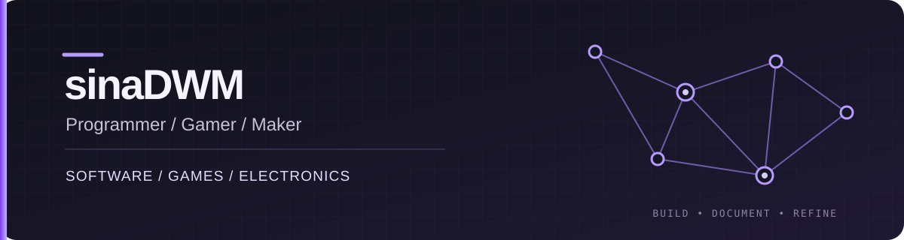

  <a href="README_FA.md">فارسی</a> · <strong>English</strong>  
  

  <h1>sinaDWM</h1>
  
Programmer since 15 · Gamer · Python software & electronics

---

### A little about me

I'm **Sina Mahmoudi**, known online as **sinaDWM**. I'm a gamer and programmer who started writing code at **15**. Games drew me to interactive systems and the small details that make an experience feel right. That curiosity now carries into the software I build and the engineering problems I explore.

My work spans **Python applications**, **Telegram systems**, **desktop tools**, **Rain to You**, and **electronics engineering projects**. I like turning experiments into useful, understandable projects: building the core, testing what I can, and documenting what actually works. This profile brings together the source I can share publicly; each project has English and Persian guidance.

Curiosity from games. Care in code. Ideas that cross software and hardware.

### Selected projects

| Project | What it does | Stack |
| --- | --- | --- |
| [PasarGuard Reseller Bot](https://github.com/sinadwm1/pasarguard-reseller-bot) | Telegram based sales and reseller operations, with payments, support, and quota synchronization. | Python · aiogram · PostgreSQL · Redis · Docker |
| [ARTIS Invoice Desktop](https://github.com/sinadwm1/artis-invoice-desktop) | Desktop workflow for customer and product records, Excel invoices, and Windows PDF export. | Python · Tkinter · SQLite · openpyxl |
| [Telegram Puzzle Bot](https://github.com/sinadwm1/telegram-puzzle-bot) | Stage based puzzles with player progress and administrator tools. | Python · Telegram Bot API · SQLite |
| [Pygame Snake](https://github.com/sinadwm1/pygame-snake) | A small desktop game with keyboard controls and collision rules. | Python · Pygame |

### Tools I use in these projects

`Python` · `SQLAlchemy` · `PostgreSQL` · `Redis` · `SQLite` · `Docker Compose` · `Tkinter` · `openpyxl` · `Telegram Bot API`

### More code

- [Python IP Toolkit](https://github.com/sinadwm1/python-ip-toolkit) — offline IP classification and list formatting.
- [Wi-Fi Network Scanner](https://github.com/sinadwm1/wifi-network-scanner) — nearby network names and signal strength.
- [Terminal Simulations](https://github.com/sinadwm1/terminal-simulations) — clearly labeled console demonstrations.
- [Tkinter Calculator Experiments](https://github.com/sinadwm1/tkinter-health-calculators) — early desktop UI exercises; not medical tools.
- [Telegram Text Substitution Bot](https://github.com/sinadwm1/telegram-substitution-bot) — character mapping demo, not encryption.

### Project documentation

Each prepared repository includes English and Persian usage notes. I keep examples and configuration separate from credentials and user data.

---

Built from real projects, documented in English and Persian.

